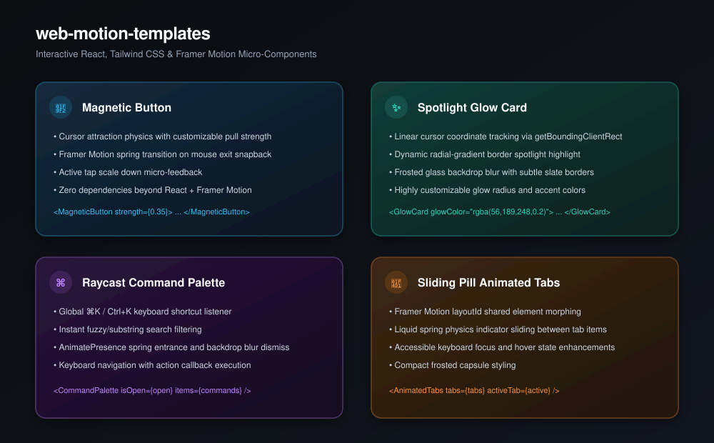

# web-motion-templates

[](https://github.com/nilkanthdesai76/web-motion-templates/actions/workflows/ci.yml)
[](https://react.dev)
[](https://www.framer.com/motion/)
[](https://tailwindcss.com)
[](LICENSE)

A curated, copy-paste ready collection of production-grade UI animations and interactive micro-components built with **React**, **Tailwind CSS**, and **Framer Motion**. Zero bloat — just grab the JSX file and drop it into your Next.js, Vite, or Remix application.

<p align="center">
  
</p>

---

## ⚡ Included Components

| Component | Description | Technique | File |
| :--- | :--- | :--- | :--- |
| **Magnetic Button** | Cursor-following magnetic physics button with spring exit snap. | Mouse position tracking + Framer spring | [`MagneticButton.jsx`](src/components/MagneticButton.jsx) |
| **Glow Card** | Spotlight cursor-following gradient highlight border. | `radial-gradient` + CSS backdrop blur | [`GlowCard.jsx`](src/components/GlowCard.jsx) |
| **Command Palette** | Raycast/Spotlight keyboard navigation modal with ⌘K shortcut. | `AnimatePresence` + keyboard shortcuts | [`CommandPalette.jsx`](src/components/CommandPalette.jsx) |
| **Animated Tabs** | Sliding liquid pill indicator tracking active tab. | Framer Motion `layoutId` shared element | [`AnimatedTabs.jsx`](src/components/AnimatedTabs.jsx) |

---

## 🚀 Quick Examples

### 1. Magnetic Button

```jsx
import { MagneticButton } from "./components/MagneticButton";

<MagneticButton strength={0.35} onClick={() => console.log("clicked")}>
  Explore Features
</MagneticButton>
```

### 2. Spotlight Glow Card

```jsx
import { GlowCard } from "./components/GlowCard";

<GlowCard glowColor="rgba(56, 189, 248, 0.25)">
  <h3 className="text-xl font-bold text-white">Edge AI Processing</h3>
  <p className="mt-2 text-slate-400">Run local models with zero latency.</p>
</GlowCard>
```

### 3. Raycast ⌘K Command Palette

```jsx
import { CommandPalette } from "./components/CommandPalette";
import { useState } from "react";

function App() {
  const [isOpen, setIsOpen] = useState(false);

  const commands = [
    { id: "1", title: "Go to Dashboard", icon: "📊", shortcut: "⌘D", action: () => router.push("/dashboard") },
    { id: "2", title: "Create New Project", icon: "✨", shortcut: "⌘N", action: () => openModal() },
  ];

  return (
    <>
      <button onClick={() => setIsOpen(true)}>Open Commands (⌘K)</button>
      <CommandPalette isOpen={isOpen} onClose={() => setIsOpen(false)} items={commands} />
    </>
  );
}
```

### 4. Sliding Pill Animated Tabs

```jsx
import { AnimatedTabs } from "./components/AnimatedTabs";
import { useState } from "react";

function TabDemo() {
  const [activeTab, setActiveTab] = useState("overview");

  const tabs = [
    { id: "overview", label: "Overview", icon: "🏠" },
    { id: "analytics", label: "Analytics", icon: "📈" },
    { id: "settings", label: "Settings", icon: "⚙️" },
  ];

  return <AnimatedTabs tabs={tabs} activeTab={activeTab} onChange={setActiveTab} />;
}
```

---

## 📄 License

This repository is licensed under the [MIT License](LICENSE).
